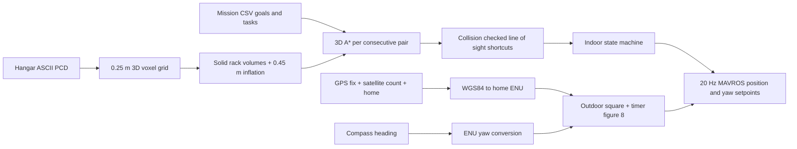
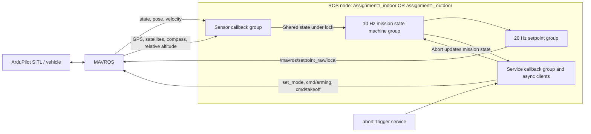

# Assignment 1 design and verification notes

## Data flow

## ROS control and concurrency

The node uses a four-thread `MultiThreadedExecutor`; sensor, state-machine,
setpoint, and service callbacks have separate mutually exclusive callback
groups. The abort callback and service replies run in the service group.
Service calls are asynchronous. The controller plans all indoor legs
before it arms, so path search cannot interrupt the setpoint timer. A lock
protects shared vehicle state and the current target.

## Decision summary

| Topic | Choice and reason | Advantages | Limitations |
|---|---|---|---|
| Map | Dense 0.25 m 3D Boolean voxel grid; the hangar is small and occupancy lookup is central to both A* and collision checks. | Simple indexing and constant-time occupancy queries. | Memory grows with the whole mapped volume; an octree would scale better. |
| Inflation | Spherical 3D dilation by 0.45 m, based on vehicle radius, hard tolerance, and margin. | One configurable operation gives clearance in every direction. | Conservative inflation can close narrow valid passages. |
| Racks | Four known shelf volumes are filled as solid boxes before inflation. | Matches the Gazebo collision intent and prevents routes through false PCD gaps. | Depends on the current hangar layout and must be updated when racks move. |
| Planner | 3D A* with 26 neighbours, Euclidean move costs, and Euclidean heuristic. | Deterministic, complete on the finite voxel graph, and naturally supports vertical movement. | Runtime and memory increase as voxel resolution becomes finer; the final continuous route is not globally optimal. |
| Post-processing | Greedy farthest-visible shortcut with a supercover collision check. | Removes most stop-and-go points and keeps every retained segment collision checked. | Corners remain sharp; no curvature or dynamic limits are optimised. |
| Indoor control | High-level position/yaw setpoints with ArduPilot's closed-loop position controller. | Reuses the tested flight controller and keeps mission logic readable. | Tracking quality depends on ArduPilot tuning and localization. |
| Arrival | Separate pass-through, soft, and hard criteria using distance, speed, and dwell time. | Intermediate path points stay smooth while task points are verified as stable. | Tight values may need retuning for wind or noisy real sensors. |
| Heading | Direction-of-travel yaw indoors, POI bearing on the square, analytic tangent on the figure-eight. | Each policy directly follows the corresponding task geometry. | Compass bias and wrap handling directly affect yaw accuracy. |
| Geodesy | Local WGS84 tangent approximation around the captured home position. | Small, dependency-free, reversible conversion with negligible curvature error over this mission. | Intended for a local field; it is unsuitable for long-distance navigation. |
| Figure-eight | Gerono curve with `A=3 m`, `omega=0.12 rad/s`, generated by the 20 Hz timer. | Continuous setpoints, bounded geometry, and a calculated 0.51 m/s maximum speed. | The fixed rate does not adapt to wind or tracking error. |

## Code simplification

Repeated sensor callbacks now share `_subscribe_sensor`, which preserves each
topic, message type, QoS, callback group, lock and receive timestamp. A common
`_parameter` helper declares and reads each existing ROS parameter. The indoor
launch route and normal mission routes share the same position/yaw aiming
helper. Related state fields are initialized together and service requests
use the ROS message constructors directly.

| Source file | Before | After |
|---|---:|---:|
| `part02/control.py` | 365 lines | 355 lines |
| `part02/indoor.py` | 185 lines | 180 lines |
| `part03/outdoor.py` | 311 lines | 262 lines |
| All Python files in the production package | 1259 lines | 1195 lines |

The state machine conditions, geometry, tolerances, deadlines and public
interfaces are preserved. Before/after comparison with identical simulated
telemetry and service replies yielded identical parameters, subscriptions,
state traces, position/yaw setpoints, service requests and visualization
paths for both supplied indoor CSV files, the outdoor mission and a temporary
GPS outage. This is a controller comparison without live MAVROS or Gazebo.

## A1.1: map and planner

The loader reads the repository's ASCII PCD, rejects non-finite points and
checks the declared point count. Coordinates are quantised with `floor` into
0.25 m XYZ cells. A dense Boolean 3D grid makes arbitrary occupancy queries
constant-time. Its drawback is memory proportional to map volume, even where
most cells are empty. An octree would be more compact for a large map.

The current Gazebo rack SDF has four shelf structures centred at X=2.695 and
5.945 m, Y=6.818 and 11.360 m. Each is treated as a solid
3.09 × 1.05 × 3.76 m box before inflation. This is deliberately more
conservative than their detailed collision members: a route cannot pass
through shelf openings. The resulting paths can detour farther or rise above
a rack, but will not exploit a false free gap in the PCD.

The default 0.45 m inflation is a spherical 3D binary dilation. The estimate
is 0.20 m vehicle radius + 0.18 m hard arrival radius + 0.07 m margin. Changing
it changes the free volume and, for blocked endpoints, may make a route
impossible. This margin assumes controller tracking remains near each segment;
corner overshoot and localization errors must be checked in the actual flight.

A* expands up to 26 neighbouring voxels. Each move costs its Euclidean 3D
length. The heuristic is the Euclidean distance to the goal, which never
overestimates the remaining path on this grid. Neighbour moves use precomputed
cell subsets to reject diagonals touching blocked corners; longer segments
use a supercover voxel ray, including rays lying on voxel faces. The exact
start connects to its voxel centre and goal connections include their actual
length. A visible goal is kept as a candidate until no queued lower bound can
improve it. This minimizes cost on the voxel graph with these endpoint
connections. Discretisation and subsequent shortcutting do not make the final
path globally optimal in continuous space. Disconnected routes exhaust the
priority queue and produce a clear error.

Post-processing greedily connects each retained point to the farthest later
point with clear voxel line of sight. The final segments are checked again
against the inflated map. It greatly reduces stops, but corners remain sharp;
no spline is applied because an unconstrained spline can cut through a rack.

Measured on 2026-10-13 with `resolution=0.25`, `safety_radius=0.45`; median of
three runs before and after review on the same machine (excluding PCD load):

| Route (map XYZ, metres) | Current raw → simplified | Before | After | Speedup |
|---|---:|---:|---:|---:|
| `(4.84,5.37,2.00)` → `(2.08,9.74,1.75)` | 27 → 4 | 1.938 s | 0.055 s | 35× |
| `(2.81,8.15,1.50)` → `(13.60,1.50,2.00)` | 45 → 3 | 1.197 s | 0.031 s | 38× |

The extra raw point is the explicitly included start voxel centre. Goal cost
handling also changes which route is selected. Both resulting routes remain
collision checked. Repeated NumPy allocations and ray tracing for adjacent
cells were the main cost removed by the optimization.

Times vary with machine load. The stand-alone `plan3d` executable prints
current values and can accept a new start and goal during the defence.

## A1.2: indoor controller

The state machine logs `IDLE → SET_MODE → ARM → TAKEOFF → TURN → NAVIGATE →
TASK`, and later `LAND`, `DONE`, `ABORT`, or `PASSIVE`. It waits for MAVROS
connection and confirms mode and arming from `/mavros/state`; service responses
are checked. The ArduPilot takeoff service commands altitude relative to home,
and landing switches to LAND mode. Setpoints are paused during takeoff and
landing so they cannot override those manoeuvres. After `landtakeoff`, the
controller waits for disarm, re-enters GUIDED, re-arms, and takes off again.
It now waits two seconds from confirmed disarm. The initial launch-to-first-row
route runs only on the initial takeoff, so it is not repeated after
`landtakeoff`. Non-finite mission coordinates and yaw tasks are rejected.

Raw planner cells are never flown. Simplified path points are pass-through
targets with a 0.35 m acceptance radius and no velocity condition. Mission
`soft` goals use 0.60 m and a 0.15 s dwell. `hard` goals use 0.18 m,
speed below 0.20 m/s, and 0.8 s dwell. `yaw` tasks require heading error
below 7 degrees for 1 s while settled. The loose radii keep the drone moving;
the tight check proves it stopped for tasks. GPS/pose noise or wind can make
the tight check slow or impossible, so these values need adjustment after
observing the real platform.

Map coordinates are from Gazebo's hangar PCD. In this world MAVROS local pose
at map `(13,7,0)` was measured near `(-7,13,0)`: XY is rotated 90 degrees.
The node uses a parameter for this rotation and calibrates translation from
the measured launch pose. Path bearing in map axes is rotated by the same
angle before publication. A `yaw180` task means 180 degrees counter-clockwise
from **MAVROS ENU East**, an absolute heading at that waypoint. Between tasks,
the nose faces the next path segment. `unwrap_near` chooses the equivalent yaw
closest to current heading across the ±π boundary.

`PositionTarget.coordinate_frame=FRAME_LOCAL_NED` names the MAVLink frame sent
to ArduPilot. The ROS message fields passed to MAVROS are still ENU; MAVROS
performs the ENU→NED conversion. The only explicit indoor transform in this
package is the measured hangar-map→MAVROS-local rotation and translation.

## A1.3: outdoor controller

The home message supplies the geodetic origin when available; otherwise the
first good fix does. The mission has no absolute target coordinates. A local
WGS84 tangent approximation uses the meridional and prime-vertical Earth
radii at home latitude. Over 50 m, ignored curvature contributes far below
1 mm of position error; GNSS error dominates. Both geodetic→ENU and ENU→
geodetic functions are implemented. The POI and square corners are formed as
geodetic coordinates then converted to local ENU setpoints. Reported position
comes from live GPS plus the home position in MAVROS's local frame. Relative
altitude is from `/mavros/global_position/rel_alt`; 5 m means above launch,
while `NavSatFix.altitude` is an absolute GNSS altitude used only for reporting.
The local altitude origin subtracts the current relative altitude to avoid
counting it twice when launch is above home. Earth radii are cached per home
latitude, and longitude differences are wrapped across the date line.

Compass heading is degrees clockwise from magnetic North. ENU yaw is radians
counter-clockwise from East: `yaw = 90° − compass − declination`. A configurable
east-positive magnetic declination accounts for the magnetic/true North
difference. Pose yaw is available separately for comparison. The square yaw
is recomputed from GPS position to the fixed POI on every setpoint tick; only
horizontal bearing is commanded, with no gimbal pitch. The default POI is at
home and the 5 m square remains within 3.54 m of it.

The square uses 20 Hz linear position setpoints at 0.30 m/s along each leg.
The drone first rotates to face the POI before moving from its launch point
to the first corner. Slower corner travel gives the yaw controller time to
track the changing POI bearing, at the cost of a longer mission.
After W4 it returns to W1 to close the square before moving to the centre.

The figure-eight uses `x=3 sin(t)`, `y=3 sin(t) cos(t)` at 20 Hz, `t=ω elapsed`.
The default `ω=0.12 rad/s` yields a 52.4 s lap and maximum speed
`3 × 0.12 × √2 = 0.51 m/s`, below the 1.5 m/s cap. The drone first settles at
the centre and aligns to the initial tangent. Every tick sends the analytic
tangent yaw `atan2(cos(2t),cos(t))`, unwrapped near measured heading. The
horizontal geofence bound is distance(home,POI) + max(square half-diagonal,
figure amplitude); altitude is also checked before arming. The 3 m amplitude
produces a 6 × 3 m ground track. After one lap,
the vehicle returns to launch at 5 m and lands.

The abort service stops setpoints and requests RTL if armed and still in
GUIDED. A pilot mode change changes state to PASSIVE without fighting the
pilot. MAVROS state or pose missing for over 5 s causes an abort. Outdoor
navigation sensors get a 5 s grace period for short outages, then also cause
an abort if still invalid. Setpoint output stops during the outage, and the
elapsed square/figure-eight time excludes it on recovery. The arming and
takeoff states also check navigation sensor validity. Non-finite parameters,
fixes, compass readings and relative altitudes cannot generate commands.
GPS, compass, relative altitude and satellite
topics use sensor-data QoS so they match the MAVROS publishers.
Vehicle battery/failsafe configuration and a safety pilot remain necessary
before physical flight.
Velocity samples older than 3 seconds cannot confirm stable arrival. Service
requests time out after 5 seconds and late replies cannot resume an aborted
mission or override pilot takeover. Visualization history is bounded by
`path_max_points` (default 2000, about 500 seconds at 4 Hz). The plot reader
deserializes only the final history message on each Path topic.

## Verification and limits

On **2026-10-18**, the workspace build, an isolated build from a clean source
copy, and all **57 tests** passed. These include an independent box/segment
collision oracle, A* cost versus Dijkstra, and mocked-controller checks with
real ROS message types. On **2026-10-20**, a fresh Git clone of `part4`
commit `d9dd12d0b6219d9d0d3dd0ef33336fd14cd29623` built successfully and all
**57 tests** passed. The build and test logs are in `verification/git_clone_build.log`
and `verification/git_clone_pytest.log`; details are in `RUN.json` under
`publication_verification`. Both supplied CSV files were previously checked for
collision-free planned routes; the new flight used `exam_example.csv`.

New Gazebo/SITL flights with the current production source replaced the
historical recordings. The indoor mission completed `yaw180`, `landtakeoff`,
`yaw90`, and final landing in **102.7 s**. The outdoor mission completed all
four square edges, the figure-eight, return, and landing in **176.6 s**.
Both reached `DONE` and disarmed. A separate airborne abort stopped setpoints,
changed the FCU to RTL, and ended landed and disarmed. Bags and logs are in
[`evidence/`](../../assignment1_mission/evidence/README.md).

[`RESULTS.md`](RESULTS.md) contains the six figures, measurement definitions,
current values, and recording procedure. Source hashes are in
[`RUN.json`](RUN.json). Square compass-to-POI error was **0.57° median / 1.42°
at the 95th percentile**. Figure-eight compass-to-tangent error was **1.29° /
4.63°**, with a **13.09°** maximum. The figure-eight lap took **52.35 s**.

The recording also exposes limits. Five of 392 indoor navigation samples
entered the inflated occupancy grid while cutting a corner; none entered
the original occupied cells. The 0.45 m planned clearance is therefore not
guaranteed by the current pass-through controller. During navigation the
distance to the nearest planned segment had a 0.072 m median and 0.612 m
maximum. This sampled check does not prove continuous collision freedom.

The setpoint timer is configured for 20 Hz, while the outdoor recording
averaged **17.02 Hz**, with a **650 ms** maximum receipt interval. Execution
under host load is not hard real time. The node's geometric fence only checks
the planned mission; RTL follows the autopilot's settings and reached
**8.86 m** in the separate abort test. These are single successful simulated
missions, not consecutive reliability trials or physical-flight validation.
