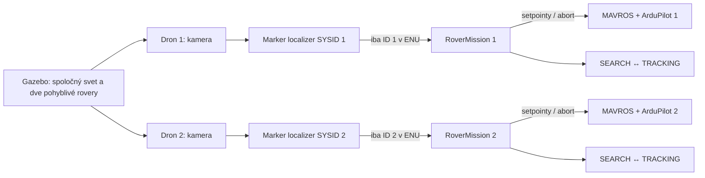

# LRS — Assignment 1 a Assignment 2

Vo vetve **`zadanie2-lrs`** pokračujeme témou **vyhľadávanie a sledovanie roverov**.
Základom je náš hotový Assignment 1 v `src/assignment1_mission`; letové riadenie
budeme ďalej používať zo spoločného balíka.

## Čo preberáme do misie s rovermi

| Hotová časť | Zdroj | Využitie pre Assignment 2 |
|---|---|---|
| `FlightNode` | [`part02/control.py`](src/assignment1_mission/assignment1_mission/part02/control.py) | MAVROS telemetria a služby, GUIDED, arming, vzlet, setpointy, abort a reakcie na stratu údajov. |
| `spin` a callback skupiny | ten istý `control.py` | Spracovanie obrazu môže bežať oddelene od riadenia a publikovania setpointov. |
| Uhlové a quaternionové funkcie | [`part02/mission.py`](src/assignment1_mission/assignment1_mission/part02/mission.py) | Napríklad `wrap`, `unwrap_near` a `yaw_from_quaternion` pri orientácii dronu a prevode detekcie. |
| Spúšťanie simulácie | [`scripts/`](scripts/) | Existujúce skripty pre Gazebo, ArduPilot SITL a MAVROS. |
| ROS balenie a testy | [`src/assignment1_mission/`](src/assignment1_mission/) | Zachovaný funkčný základ, existujúce testy a príkazy `plan3d`, `indoor`, `outdoor`. |

Nový roverový uzol bude dediť z `FlightNode` a pridá vlastné spracovanie obrazu
a rozhodovanie v `mission_tick()`. Vzlet, MAVROS služby, časovače a abort tak
použije zo spoločnej implementácie. Roverová misia podľa zadania pri bežnom
sledovaní nepristáva.

**Stav prípravy:** táto vetva obsahuje hotový kód Assignmentu 1, zadanie,
prezentáciu, školský randomizér a balík `assignment2_rover` pre spustenie dvoch
dronov, pripojenie kamier a detekciu vlastnej ArUco značky. Prevod detekcie do
ENU a roverový letový riadiaci uzol patria do nasledujúcich krokov.

### Krok 1 — oddelenie komunikácie dronov: hotovo

`FlightNode` používa relatívne názvy `mavros/...`. Každá inštancia preto smeruje
telemetriu, setpointy a MAVROS služby do svojho ROS namespace. Abort zostáva
súkromnou službou uzla `~/abort`. Rovnakú úpravu majú aj ďalšie senzorové
odbery outdoor misie.

| Namespace uzla | Telemetria | Setpointy | Abort uzla `assignment1_indoor` |
|---|---|---|---|
| `/` (predvolené) | `/mavros/state` | `/mavros/setpoint_raw/local` | `/assignment1_indoor/abort` |
| `/drone_1` | `/drone_1/mavros/state` | `/drone_1/mavros/setpoint_raw/local` | `/drone_1/assignment1_indoor/abort` |
| `/drone_2` | `/drone_2/mavros/state` | `/drone_2/mavros/setpoint_raw/local` | `/drone_2/assignment1_indoor/abort` |

Namespace možno zadať cez `--ros-args -r __ns:=/drone_1` alebo pri vytváraní
uzla cez `namespace='/drone_1'`. MAVROS príslušného dronu má používať rovnaký
namespace. Pôvodné príkazy indoor a outdoor bez namespace zachovávajú rozhrania
Assignmentu 1.

Zostavenie balíka a **63 testov** prešlo: 57 pôvodných a 6 nových kontrol
názvov, smerovania telemetrie, setpointov a izolácie abort/RTL. Nové kontroly
používajú skutočné ROS správy a služby v oddelenej doméne bez autopilota a letu.
Po zostavení ich možno spustiť aj samostatne, bez mapy:

```bash
source /opt/ros/jazzy/setup.bash
source install/setup.bash
/usr/bin/python3 -m pytest -q src/assignment1_mission/test/part02/test_namespaces.py
```

### Krok 2 — spustenie dvoch dronov a kamier: hotovo

Po pripojení externých dát a zostavení **oboch balíkov** podľa návodu nižšie
spúšťaj nasledujúce terminály z koreňa `LRS-URK2`. V termináloch 2–4 a pri
kontrole vždy najprv načítaj prostredie:

```bash
source /opt/ros/jazzy/setup.bash
source install/setup.bash
```

**Terminál 1 — spoločný svet Gazebo:**

```bash
source /opt/ros/jazzy/setup.bash
scripts/run_gazebo.sh fei_lrs_precision_landing.world
# Bez grafického okna, so zachovaným renderovaním kamier:
# scripts/run_gazebo.sh fei_lrs_precision_landing.world -s --headless-rendering
```

**Terminál 2 — prvý SITL:**

```bash
ros2 run assignment2_rover sitl --vehicle 1
```

**Terminál 3 — druhý SITL:**

```bash
ros2 run assignment2_rover sitl --vehicle 2
```

Tieto príkazy používajú už zostavený `~/ardupilot/build/sitl/bin/arducopter`.
Ak chýba, zostav ho raz pred spustením oboch inštancií:

```bash
cd ~/ardupilot
./waf configure --board sitl
./waf copter
```

Inú inštaláciu vyber cez `--ardupilot-dir /cesta/ardupilot` alebo premennú
`ARDUPILOT_DIR`. SITL beží priamo bez MAVProxy; každá inštancia má vlastné
parametre a logy v `log/sitl/drone_N`. Iný rodičovský priečinok zadaj cez
`--run-dir /cesta/k/stavom`. Súčasne spúšťaj iba jednu inštanciu každého SYSID.

| Dron / namespace | SYSID | SITL instance | FDM UDP | MAVLink UDP | Home (lat, lon, alt, yaw) |
|---|---:|---:|---:|---:|---|
| `/drone_1` | 1 | 0 | 9002 | 14550 | `48.15135451,17.07361560,150,0` |
| `/drone_2` | 2 | 1 | 9012 | 14560 | `48.15135451,17.07388440,150,0` |

**Terminál 4 — oba MAVROS, telemetria a mosty kamier:**

```bash
ros2 launch assignment2_rover bringup.launch.py
```

Launch načíta MAVROS pluginy `sys_status`, `sys_time`, `command`, `imu`,
`local_position` a `setpoint_raw`. Poskytujú rozhrania potrebné pre `FlightNode`.
Uzol `telemetry_setup` v každom namespace postupne požiada cez
`mavros/set_message_interval` o `HEARTBEAT` pri 5 Hz a `ATTITUDE` a
`LOCAL_POSITION_NED` pri 10 Hz simulačného času. Častejší heartbeat pomáha aj
pri spomalení simulácie dodržať časový limit spojenia MAVROS v reálnom čase.
Po obnovení spojenia požiadavky zopakuje; odmietnutú požiadavku alebo timeout
skúsi znova. Nepotrebuje názvy streamových parametrov konkrétnej verzie
ArduPilota. [Služba MAVROS](https://github.com/mavlink/mavros/blob/2.15.1/mavros/src/plugins/sys_status.cpp)
používa príkaz `MAV_CMD_SET_MESSAGE_INTERVAL`.

Kamery sa prenášajú iba smerom Gazebo → ROS s QoS `SENSOR_DATA`. Názvy nižšie
sú overované pre oba drony; `N` nahraď číslom 1 alebo 2:

| ROS topic | ROS typ | Zdroj v Gazebo |
|---|---|---|
| `/drone_N/mavros/state` | `mavros_msgs/msg/State` | ArduPilot cez MAVLink |
| `/drone_N/mavros/local_position/pose` | `geometry_msgs/msg/PoseStamped` | ArduPilot cez MAVLink |
| `/drone_N/mavros/local_position/velocity_local` | `geometry_msgs/msg/TwistStamped` | ArduPilot cez MAVLink |
| `/drone_N/down_camera/image_raw` | `sensor_msgs/msg/Image` | Rovnaký názov, `gz.msgs.Image` |
| `/drone_N/down_camera/camera_info` | `sensor_msgs/msg/CameraInfo` | Rovnaký názov, `gz.msgs.CameraInfo` |

**Terminál 5 — pohyb roverov a kontrola vstupov:**

Randomizér spusti podľa nasledujúcej sekcie. V ďalšom termináli s načítaným
ROS prostredím over živé správy:

```bash
ros2 run assignment2_rover check_bringup \
  --duration 15 --timeout 90 --output log/rover_bringup.json
```

Kontrola čaká na oba správne `target_system_id`, pripojené FCU, platnú polohu,
rýchlosť, obraz a kalibráciu. Potom meria všetkých desať tokov počas celého
intervalu. Vyžaduje viacero správ, postupujúce časové značky a čerstvé dáta;
overí aj zhodu rozmerov a rámcov obrazu s `camera_info`. Vypíše frekvencie
podľa času počítača aj zdrojových značiek, uloží JSON a vráti `PASS` / kód 0
alebo `FAIL` / kód 1. Existencia topicu sama nestačí.

Táto zostava pripravuje vstupy misie. Spustenie týchto príkazov drony nearmuje
ani nespúšťa letové riadenie.

**Overené 18. 11. 2026:** zostavenie oboch balíkov a 73 testov prešlo. Živý
beh v Gazebo Harmonic s dvoma SITL a pohybom roverov pri `--seed 42` skončil
`PASS` pre všetkých desať tokov počas 20 s. Drony boli pripojené, nearmované,
v režime `STABILIZE`; overené target SYSID boli 1 a 2.

| Vstup | Dron 1 (Hz v reálnom čase) | Dron 2 (Hz v reálnom čase) |
|---|---:|---:|
| Stav / heartbeat | 5,00 | 5,00 |
| Lokálna poloha | 10,00 | 10,00 |
| Lokálna rýchlosť | 10,00 | 10,00 |
| Obraz RGB 640 × 480 | 27,00 | 29,65 |
| `camera_info` | 30,30 | 30,30 |

Obe kamery majú `fx = fy ≈ 554,38 px`, `cx = 320`, `cy = 240` a nulové
koeficienty skreslenia. Skutočné rámce kamier sú
`drone_N/drone_N/down_cam_link/down_camera`; lokálna poloha má hlavičku `map`
a rýchlosť `base_link`, rozlíšené ROS namespace príslušného dronu.
Lokálny report s počtami správ, frekvenciami a kalibráciou je
[`log/step2_final_pedcbjy9/bringup.json`](log/step2_final_pedcbjy9/bringup.json),
výsledky testov sú vedľa v `pytest.xml`. Priečinok `log` sa neukladá do Gitu.
Frekvencie závisia od výkonu počítača; počas spomalenia simulácie boli nižšie.
Obrazy aj detektor používajú čas Gazebo. V kroku 4 nastavujeme rovnaký čas aj
pre MAVROS; tým sa dajú bezpečne porovnať časové značky obrazu a polohy.

### Krok 3 — detekcia vlastnej značky: hotovo

Číslovanie týchto krokov vychádza z [nášho plánu](PLAN.md). Tu pripravujeme
obrazový vstup pre budúci roverový riadiaci uzol: štyri rohy vlastnej značky
v pixeloch. Vzlet a vyhľadávací let zo sekcie §2 zadania patria do kroku 5.

`MarkerVision` z [vision.py](src/assignment2_rover/assignment2_rover/vision.py)
sa dá pripojiť k existujúcemu `FlightNode`. Samostatný uzol `marker_detector`
umožňuje overiť kameru a detekciu pred pripojením letovej logiky:

- `cv_bridge` prevedie správu `Image` na sivý obraz; OpenCV hľadá `DICT_4X4_50`.
  Používa dostupné API: tu overené OpenCV 4.6 s `detectMarkers`, pri novšom
  rozhraní `ArucoDetector`. [Dokumentácia OpenCV 4.6](https://docs.opencv.org/4.6.0/d9/d6a/group__aruco.html),
  [aktuálne rozhranie detekcie](https://docs.opencv.org/4.x/d5/dae/tutorial_aruco_detection.html).
- SYSID musí zodpovedať `mavros/target_system_id`, ktorý uzol pravidelne
  overuje. Cudzie značky sa môžu objaviť v diagnostike, ale nevytvoria cieľ.
  Nejednoznačná detekcia viacerých značiek s vlastným ID sa tiež odmietne.
- Vlastná značka sa potvrdí po troch po sebe idúcich **spracovaných** snímkach.
  Snímka bez vlastnej značky alebo neplatný vstup prerušia potvrdzovanie.
- Odber obrazu má hĺbku 1 a jednosnímkovú schránku: nová čakajúca snímka
  nahradí staršiu. Kontroluje sa formát, časová značka, vek pred aj po
  spracovaní a geometria rohov. Opakované, staré a budúce snímky sa zahodia.
- OpenCV beží v samostatnej callback skupine, mimo zámku `FlightNode`.
  Štyri vlákna executora umožňujú súbežný príjem obrazu, spracovanie,
  diagnostiku a letové časovače. Watchdog používa monotónny čas a nechá
  detekciu vypršať aj pri zastavení simulácie.

Po zostavení a načítaní prostredia spusti zostavu z kroku 2 a v ďalšom
termináli jeden detektor:

```bash
source /opt/ros/jazzy/setup.bash
source install/setup.bash
ros2 launch assignment2_rover detector.launch.py vehicle:=1
```

Launch nastaví `/drone_1`, SYSID 1 a `use_sim_time:=true`; čas Gazebo prichádza
cez nový jednosmerný most `/clock`. Pre druhý namespace slúži `vehicle:=2`.
Dron stojaci na zemi môže hlásiť `WAIT_IMAGE`: značka musí byť v zornom poli
nadol orientovanej kamery. Spustenie detektora neposiela letové príkazy.

| Parameter / launch argument | Predvolené | Význam |
|---|---:|---|
| `vehicle` | 1 | Launch vyberie namespace a zodpovedajúci parameter `sysid`. |
| `confirm_frames` | 3 | Počet po sebe idúcich spracovaných detekcií vlastného ID. |
| `max_frame_age` | 0,5 s | Najvyšší vek od zachytenia podľa času Gazebo aj od príjmu podľa času počítača. |
| `processing_hz` | 20 | Horná frekvencia spracovania; skutočná závisí od času detekcie a príchodu obrazu. |

Hodnoty sa nastavujú pri spustení a počas behu sú iba na čítanie. Napríklad:

```bash
ros2 launch assignment2_rover detector.launch.py vehicle:=1 \
  confirm_frames:=5 max_frame_age:=0.4 processing_hz:=15.0

ros2 topic echo /drone_1/marker_detector/status
ros2 topic echo /drone_1/marker_detector/corners
```

`~/status` je `diagnostic_msgs/msg/DiagnosticArray`: zobrazuje `WAIT_ID`,
`WAIT_IMAGE`, `CANDIDATE` alebo `CONFIRMED`, posledné videné ID, počet spracovaní,
zahodení a nahradených snímok. `last_rejection` uchováva dôvod posledného
zahodenia. `overwritten` môže bežne rásť pri 30 Hz kamere a 20 Hz spracovaní.

`~/corners` je `geometry_msgs/msg/PolygonStamped` a publikuje sa pri novej
potvrdenej detekcii vlastného ID. Hlavička ostáva z obrazu; štyri body majú
`x, y` v pixeloch a `z = 0`. Zachováva sa poradie rohov dekódovanej značky
z OpenCV. Vlastné ID je pevne určené SYSID uzla a uvedené v diagnostike.
Pre budúce riadenie poskytuje `snapshot()` čerstvú detekciu vrátane SYSID,
rozmerov obrazu a času príjmu; po vypršaní vracia `None`.

**Overené 18. 11. 2026:** prešlo **86 testov** (73 predchádzajúcich + 13
nových). Test so skutočnými ROS správami overil, že počas umelo zablokovaného
spracovania obrazu ďalej prichádzajú setpointy zo spoločného `FlightNode`.
Tento test používa oddelenú ROS doménu a simulované údaje bez autopilota.

V dočasnej testovacej kópii školského sveta bola kamera dronu 1 zafixovaná
vo výške 5 m nad dvoma pôvodnými modelmi roverov. Z reálneho obrazu Gazebo
sa detegovali obe textúry ID 1 a 2; ROS výstup obsahoval iba rohy ID 1.
Po odstránení roveru 1 ostalo viditeľné ID 2 a počas ďalších 3 s neprišiel
žiadny cieľ. Oba SITL zostali pripojené a nearmované. Výsledok obrazovej
kontroly je [`log/step3_live_g6vrb7pm/vision.json`](log/step3_live_g6vrb7pm/vision.json),
surový obraz `both_markers.png` a výsledky testov `pytest.xml` sú vedľa.
Táto kontrola overuje obrazové spracovanie; autonómny let sa overí v kroku 5.

### Krok 4 — poloha značky v lokálnom ENU: hotovo

Spusti namiesto obyčajného detektora uzol, ktorý z potvrdených rohov vypočíta
stred vlastnej značky v lokálnom rámci MAVROS:

```bash
ros2 launch assignment2_rover detector.launch.py vehicle:=1 estimate_position:=true
ros2 topic echo /drone_1/marker_localizer/target
ros2 topic echo /drone_1/marker_localizer/projection_status
```

`marker_localizer` používa maticu kamery `K` a koeficienty skreslenia `D` zo
živého `down_camera/camera_info`. Rozmer štvorca je odvodený z modelu roveru:
texturovaná plocha má 0,85 m a tmavý ArUco štvorec zaberá 800 z 1066 texelov,
preto je použitá šírka `0,85 × 800 / 1066 = 0,638 m`. Konfiguráciu možno meniť
v `src/assignment2_rover/config/projection.yaml`.

Prevod z obrazového rámca kamery do lokálneho ENU zahŕňa polohu kamery 3 cm pod
telom dronu, jej orientáciu podľa SDF modelu aj celý quaternion orientácie
dronu z MAVROS. Poloha a orientácia dronu sa interpolujú na čas snímky
(lineárna interpolácia polohy, SLERP quaternionu). Uzol odmietne starý údaj,
neplatnú kalibráciu, chýbajúcu pózu v časovom intervale alebo PnP riešenie s
veľkou reprojekčnou chybou. Jeho vstupom nie je Gazebo ground truth.

Výstup `~/target` je `geometry_msgs/msg/PointStamped`; jeho hlavička zachováva
čas snímky a rámec lokálnej polohy MAVROS. Diagnostika `~/projection_status`
uvádza stav `WAIT_CALIBRATION`, `WAIT_POSE`, `REJECTED` alebo `VALID`, spolu s
rozsahom, reprojekčnou chybou a použitým intervalom polôh.

**Overené 24. 11. 2026:** čistá zostava oboch balíkov prešla a všetkých **91
testov** Assignmentu 1 a 2 prešlo cez `pytest`. Numerické testy pokrývajú
čelnú aj šikmú značku, interpoláciu pózy, úplnú orientáciu dronu a predvolené
parametre. V Gazebo Harmonic bola kamera dronu 1 staticky umiestnená 5 m nad
dvoma značkami. Z 30 odhadov nad roverom 1 bola priemerná odchýlka voči
časovo spárovanej modelovej polohe **5,4 cm** (RMSE 5,4 cm; maximum 5,5 cm).
Oba SITL zostali pripojené a nearmované. Je to geometrická kontrola pri
pevnej polohe; autonómny let ešte nebol vykonaný. Surový report je lokálne v
`log/step4_live_lqejizjn/vision.json`; priečinok `log` sa do Gitu neukladá.

Nové časti Assignmentu 2 sú pripojenie dvoch kamier, detekcia vlastného ArUco ID,
prevod detekcie do ENU, vyhľadávanie, sledovanie a návrat k vyhľadávaniu pri
strate značky. Podrobnosti sú v [zadaní roverovej misie](assignments/assignment2/rover-find-and-follow.md).

### Krok 5 — autonómne nájdenie a sledovanie roveru: hotovo pre jeden dron

Po spustení Gazebo, oboch SITL a MAVROS podľa kroku 2 spusti randomizér a
vyhľadávaciu misiu. Každý príkaz patrí do samostatného terminálu:

```bash
# Terminál 5 — pohyb oboch roverov
scripts/randomize_rovers.py --seed 42

# Terminál 6 — kamera, lokalizácia a misiu riadiaci uzol pre dron 1
ros2 launch assignment2_rover rover_mission.launch.py vehicle:=1
```

Misia sama nastaví GUIDED, vyarmuje dron, vzlietne do výšky vyhľadávania a
potom hľadá vlastnú značku. Sleduje iba ArUco ID zhodné so `SYSID_THISMAV`.
Po potvrdení čerstvého bodu zo `marker_localizer` prejde do TRACKING a drží
nastavenú výšku nad roverom. Ak bod dlhšie než timeout nepríde, zahodí starú
polohu cieľa a pokračuje v SEARCH od aktuálneho úseku trasy.

| Parameter | Predvolená hodnota | Účel |
|---|---:|---|
| `search_width`, `search_length` | 30 m, 30 m | Rozmery prehľadávanej oblasti okolo miesta štartu. |
| `lane_spacing` | 5 m | Rozstup rovnobežných úsekov lawnmower trasy. |
| `search_altitude` | 19 m | Výška skenovania; prekonáva 17,2 m kolízny obal veľkého stromu v dodanom svete. |
| `track_altitude` | 2 m | Požadovaná výška nad odhadnutým stredom roverovej značky. |
| `search_speed`, `tracking_speed` | 0,8 m/s, 0,6 m/s | Limity horizontálnej rýchlosti v danom režime. |
| `target_timeout` | 1 s | Ako dlho sa drží posledný čerstvý cieľ pred návratom do SEARCH. |
| `max_target_age` | 0,75 s | Najvyšší povolený vek časovej značky lokalizácie. |

Parametre možno meniť pri spustení, napríklad `vehicle:=2 search_altitude:=18.0
track_altitude:=2.5 tracking_speed:=0.4`. Vyhľadávacia trasa používa iba
počiatočnú polohu MAVROS, rozmery oblasti a rozstup úsekov; nepozná polohu ani
dráhu roveru. Vertikálny setpoint je rýchlostný: P regulátor drží požadovanú
výšku a obmedzuje zvislú rýchlosť na ±0,5 m/s. Horizontálna rýchlosť je
obmedzená samostatne.

Priebeh možno sledovať v ďalšom termináli:

```bash
ros2 topic echo /drone_1/rover_mission/rover_status
ros2 topic echo /drone_1/marker_localizer/status
```

Prvý topic ukazuje stav `SEARCH`, `TRACKING` alebo `ABORT`, aktuálny index
trasy, vek cieľa a požadovanú rýchlosť. Druhý ukazuje viditeľné ID, počet
potvrdzovacích snímok a stav kamerového spracovania. Bezpečné prerušenie:

```bash
ros2 service call /drone_1/rover_mission/abort std_srvs/srv/Trigger '{}'
```

Abort zastaví setpointy a pri pripojenom armed drone v GUIDED požiada
ArduPilot o RTL. Sledovanie samo neprechádza do LAND.

**Overené 24. 11. 2026:** zostavenie a **97 testov** prešli. Pri jednom
aktívnom drone, druhom nearmovanom SITL a roveroch s náhodným pohybom pri
seede 42 kamera potvrdila vlastné ID 1. Zaznamenali sa prechody
`SEARCH → TRACKING → SEARCH → TRACKING`: pri krátkej strate obrazu vypršal
timeout, misia opustila starý cieľ a po opätovnej detekcii pokračovala v
sledovaní. Abort uspel a ArduPilot prešiel do RTL. Rover bol viditeľný už
krátko po dosiahnutí vyhľadávacej výšky, preto tento beh neoveruje prejdenie
celej lawnmower trasy. Spoločné súbežné sledovanie oboma dronmi patrí do
kroku 6. Lokálny report je v `log/step5_live_89wiygwp/step5.json` a nie je
priložený v Gite.

### Krok 6 — spoločná misia dvoch dronov

Spoločná misia spúšťa rovnaký `rover_mission.launch.py` dvakrát, raz pre každý
SYSID. Každý launch vytvorí lokalizátor vlastnej značky a riadiaci uzol vo
vlastnom namespace. Pred letom nechaj svet bežať, over oba FCU a kamery a daj
ArduPilot EKF čas ustáliť sa. Ak sa riadiaci uzol spustí príliš skoro, armovanie
môže byť odmietnuté; vtedy ukonči tie uzly a spusti ich znovu až po ustálení.

Po spustení Gazebo, SITL 1, SITL 2 a `bringup.launch.py`, vykonaj:

```bash
# Terminál 5 — vyber seed; použi iný seed pri opakovanom meraní
scripts/randomize_rovers.py --seed 101

# Terminál 6 — over, že oba FCU a kamery posielajú živé dáta
source /opt/ros/jazzy/setup.bash
source install/setup.bash
ros2 run assignment2_rover check_bringup \
  --duration 5 --timeout 90 --output log/step6_bringup_seed101.json
```

Po úspešnom `PASS` nechaj simuláciu ešte približne 20 sekúnd bežať, aby sa
ustálil odhad polohy. Potom spusti misie v dvoch samostatných termináloch:

```bash
# Terminál 7
source /opt/ros/jazzy/setup.bash
source install/setup.bash
ros2 launch assignment2_rover rover_mission.launch.py vehicle:=1

# Terminál 8
source /opt/ros/jazzy/setup.bash
source install/setup.bash
ros2 launch assignment2_rover rover_mission.launch.py vehicle:=2
```

Oba drony autonómne prepnú `IDLE → SET_MODE → ARM → TAKEOFF → SEARCH`.
Každý detektor prijíma iba značku s ID zhodným s vlastným SYSID. Pri jej nájdení
prejde príslušný riadiaci uzol do `TRACKING`; ak čerstvá poloha prestane
prichádzať, zahodí cieľ a pokračuje v `SEARCH`. Sleduj oba stavy:

```bash
ros2 topic echo /drone_1/rover_mission/rover_status
ros2 topic echo /drone_2/rover_mission/rover_status
```

Abortuj drony samostatne a skontroluj oba MAVROS režimy:

```bash
ros2 service call /drone_1/rover_mission/abort std_srvs/srv/Trigger '{}'
ros2 service call /drone_2/rover_mission/abort std_srvs/srv/Trigger '{}'
ros2 topic echo /drone_1/mavros/state
ros2 topic echo /drone_2/mavros/state
```

`armed: true` spolu s `mode: RTL` znamená, že autopilot prijal návrat domov.
Ak chceš opakovať skúšku s iným seedom, najprv korektne ukonči obe misie,
MAVROS, SITL aj Gazebo a spusti čerstvý svet; napríklad použi `--seed 202`.



**Overené 24. 11. 2026:** dva spoločné behy so seedmi **101** a **202**.
V oboch behoch oba uzly potvrdili vlastnú značku, zaznamenali aspoň jeden
prechod `SEARCH → TRACKING → SEARCH → TRACKING` po strate a opätovnom nájdení
a správne oddelili ID: dron 1 sledoval ID 1 a dron 2 ID 2. Abort každého uzla
vrátil úspech a oba autopiloty prešli do `RTL`. Päťsekundová kontrola všetkých
desiatich vstupných tokov prešla pri oboch seedoch. Pri seede 202 boli namerané
stav 5 Hz, poloha/rýchlosť 9,99 Hz, obraz 24,28/29,30 Hz a `camera_info`
30,30 Hz. Čisté zostavenie oboch balíkov a **97 testov** prešli. JSON
meraní je lokálny v `log/step6_bringup_seed101.json` a
`log/step6_bringup_seed202.json`; priečinok `log` nie je verzovaný.

Tieto behy demonštrujú funkčnosť v simulátore, nie bezpečnú koordináciu dvoch
skutočných lietadiel. Každý dron plánuje hľadanie nezávisle; systém neprideľuje
neprekrývajúce sa oblasti a neobsahuje vyhýbanie sa druhému dronu. Samotný
spoločný let preto nie je dôkazom bezpečnosti pri reálnom nasadení.

### Dodaný pohyb roverov

Použi školský svet `fei_lrs_precision_landing.world` a jeho zodpovedajúce modely,
pripojené cez `worlds` a `models` podľa návodu nižšie. Dodaný skript bol prevzatý
zo školskej vetvy `feat/presentation-assignment-2`, verzia `99602ce`:

```bash
scripts/run_gazebo.sh fei_lrs_precision_landing.world
# V ďalšom termináli, keď svet beží:
scripts/randomize_rovers.py --seed 42
```

Randomizér komunikuje priamo s Gazebo cez jeho Python bindings. Odoberá
`/model/aruco_rover_1/odometry` a `/model/aruco_rover_2/odometry` a posiela
rýchlostné príkazy na príslušné `cmd_vel`. Je to školský nástroj na pohyb roverov;
budúci vizuálny riadiaci uzol bude ich polohu získavať z kamier. Dostupné
parametre zobrazí `scripts/randomize_rovers.py --help`.

## Existujúci Assignment 1 — zostavenie a spustenie

Kompletný balík `assignment1_mission` na plánovanie trasy a vykonanie vnútornej
aj vonkajšej misie cez MAVROS a ArduPilot.

- **`part1`, `part2`, `part3`**: samostatné pôvodné moduly.
- **`assignment1`**: ich zlúčená história a kód v priečinkoch `part01` až `part03`.
- **`devel`**: podporné ROS balenie, testy, skripty a CSV.
- **`main`**: spustiteľný celok vzniknutý zlúčením `assignment1` a `devel`.

Nižšie uvedené príkazy na zostavenie a spustenie fungujú priamo vo vetve **`zadanie2-lrs`**.

```text
src/assignment1_mission/
├── assignment1_mission/
│   ├── part01/       # voxelová mapa, A*, príkaz plan3d
│   ├── part02/       # CSV, spoločný FlightNode, indoor misia
│   └── part03/       # GPS ↔ lokálne ENU, outdoor misia
├── test/            # 57 pôvodných + 6 kontrol namespaces
├── tools/           # spracovanie externých rosbagov
├── resource/
├── package.xml
├── setup.cfg
└── setup.py
scripts/             # spustenie Gazebo, SITL a MAVROS
missions/            # tri CSV misie pre indoor
```

## Prostredie a externé dáta

Používame Ubuntu s **ROS 2 Jazzy**, `colcon`, systémový Python 3, NumPy, SciPy,
pytest a ROS balíky uvedené v `package.xml` vrátane MAVROS. Simulácia vyžaduje
funkčnú školskú inštaláciu Gazebo, pluginu `ardupilot_gazebo`, ArduPilot SITL
a MAVProxy. Tieto komponenty sa týmto repozitárom neinštalujú.

```bash
git clone --branch zadanie2-lrs https://github.com/LubosValkovic/LRS.git LRS-URK2
cd LRS-URK2

# Absolútna cesta k existujúcemu školskému workspace s dátami:
LRS_DATA_ROOT=/home/user/gitLRS/LRS-URK
ln -s "$LRS_DATA_ROOT/maps" maps
ln -s "$LRS_DATA_ROOT/models" models
ln -s "$LRS_DATA_ROOT/worlds" worlds
```

Pripojené dáta musia obsahovať `maps/FEI_LRS_PCD/map.pcd`, modely pre dané svety
a súbory `worlds/fei_lrs_gazebo.world`, `worlds/fei_lrs_outdoor.world` a pre
Assignment 2 aj `worlds/fei_lrs_precision_landing.world` s kamerami a rovermi.
Symlinky ignoruje Git. Mapy, point cloudy, modely, svety a rosbagy sa do vetvy
neukladajú. Samotné zostavenie balíka tieto dáta nepotrebuje.

### A note on Gazebo versions

Použi Gazebo a zostavenie pluginu `ardupilot_gazebo` z rovnakého školského
prostredia. Pri viacerých verziách Gazebo musí `GZ_SIM_SYSTEM_PLUGIN_PATH`
ukazovať na plugin zostavený pre verziu spúšťanú príkazom `gz sim`.
Skripty preberajú túto premennú z tvojho prostredia.

## Zostavenie

Z koreňa repozitára, v termináli so systémovým Python prostredím:

```bash
source /opt/ros/jazzy/setup.bash
colcon build --symlink-install --packages-select assignment1_mission assignment2_rover
source install/setup.bash
ros2 pkg executables assignment1_mission
ros2 pkg executables assignment2_rover
colcon test --packages-up-to assignment2_rover --python-testing pytest
colcon test-result --all --verbose
```

Assignment 1 registruje `plan3d`, `indoor` a `outdoor`; Assignment 2 registruje
`sitl`, `telemetry_setup`, `check_bringup`, `marker_detector` a `marker_localizer`. Po zmene zdrojových
súborov zopakuj zostavenie. Python prostredie pre SITL používaj v jeho vlastnom
termináli.

## Samostatné plánovanie — part01

Po zostavení a načítaní `install/setup.bash`:

```bash
ros2 run assignment1_mission plan3d \
  --map maps/FEI_LRS_PCD/map.pcd \
  --start 4.84 5.37 2.0 --goal 2.08 9.74 1.75 \
  --resolution 0.25 --safety-radius 0.45
```

Gazebo ani MAVROS netreba. Plánovač vytvorí voxelovú mapu, rozšíri prekážky
podľa bezpečnostného polomeru, nájde trasu pomocou A* a zjednoduší ju pri
zachovaní kontroly kolízií. Vypíše čas plánovania a výsledné body.

## Vnútorná misia — part02

Vo všetkých štyroch termináloch prejdi do koreňa tohto repozitára.
Spúšťaj ich v uvedenom poradí a nechaj bežať.

**Terminál 1 — Gazebo:**

```bash
source /opt/ros/jazzy/setup.bash
scripts/run_gazebo.sh
```

**Terminál 2 — ArduPilot SITL:**

```bash
# Ak používaš toto školské Python prostredie, najprv ho aktivuj:
# source ~/venv-ardupilot/bin/activate
scripts/run_sitl.sh
```

Skript predpokladá ArduPilot v `~/ardupilot`. Inú cestu nastav pomocou
`ARDUPILOT_DIR=/absolutna/cesta/ardupilot scripts/run_sitl.sh`.

**Terminál 3 — MAVROS:**

```bash
source /opt/ros/jazzy/setup.bash
scripts/run_mavros.sh
```

**Terminál 4 — misia:**

```bash
source /opt/ros/jazzy/setup.bash
source install/setup.bash
ros2 run assignment1_mission indoor --ros-args \
  -p mission_file:="$PWD/missions/defense_mission_2.csv" \
  -p map_file:="$PWD/maps/FEI_LRS_PCD/map.pcd" \
  -p resolution:=0.25 -p safety_radius:=0.45
```

Uzol čaká na pripojenie a potrebnú telemetriu. `FlightNode` zabezpečuje
prepnutie do GUIDED, arming, vzlet, posielanie setpointov a pristátie.
Zmeny stavu sa vypisujú ako `state -> ...`; úspešné dokončenie je `DONE`.

CSV má hlavičku `x,y,z,precision,task`. Súradnice sú v mapovom rámci v metroch,
`precision` je `soft` alebo `hard`. Prvý bod musí mať `takeoff`, posledný `land`;
medzi nimi možno použiť `-`, `yaw90` či iný uhol v stupňoch a `landtakeoff`.
Alternatívne CSV sú `missions/exam_example.csv` a `missions/mission_3_all.csv`.
Pri zmene cesty zmeň parameter `mission_file`. Uzol naplánuje trasy medzi bodmi
pomocou part01 pri spustení.

Pre školský indoor svet sa používa `map_launch:=[13.0,7.0,0.0]` a
`map_to_local_yaw_deg:=90.0`. Posun do MAVROS lokálneho ENU sa odmeria pri
štarte. Ak zmeníš svet alebo miesto vzletu, nastav príslušné parametre.

## Vonkajšia misia — part03

Po ukončení indoor simulácie spusti samostatnú outdoor simuláciu. Poradie
terminálov zostáva Gazebo → SITL → MAVROS → misia.

**Terminál 1:**

```bash
source /opt/ros/jazzy/setup.bash
scripts/run_gazebo.sh fei_lrs_outdoor.world
```

**Terminál 2** (s rovnakým prostredím SITL ako pri indoor):

```bash
HOME_LOCATION=48.15144444,17.07375000,150,0 scripts/run_sitl.sh
```

**Terminál 3:**

```bash
source /opt/ros/jazzy/setup.bash
scripts/run_mavros.sh
```

**Terminál 4:**

```bash
source /opt/ros/jazzy/setup.bash
source install/setup.bash
ros2 run assignment1_mission outdoor --ros-args \
  -p poi_east:=0.0 -p poi_north:=0.0 \
  -p square_side:=5.0 -p square_speed:=0.30 \
  -p figure_amplitude:=3.0 -p omega:=0.12 \
  -p flight_altitude:=5.0 -p magnetic_declination_deg:=0.0
```

Outdoor nepoužíva CSV ani voxelový plánovač. Z parametrov vytvorí uzavretý
štvorec okolo POI a plynulú osmičku, potom sa vráti na miesto vzletu a pristane.
Používa GPS, kompas a relatívnu výšku; GPS prevádza do lokálneho ENU.
Pred štartom čaká okrem iného na platný GPS fix a aspoň osem satelitov.

`poi_east` a `poi_north` sú metre od home, `square_speed` je m/s a `omega`
je rad/s. Parametre sa načítavajú pri spustení uzla; nové hodnoty zadaj cez
`--ros-args -p nazov:=hodnota` pri ďalšom spustení. Kontroly odmietnu neplatné
hodnoty a prekročenie nastavenej oblasti letu.

Konzola vypisuje stavy, GPS a ENU. Priebežné trasy sú dostupné na
`/assignment1_outdoor/target_path` a `/assignment1_outdoor/actual_path`;
v RViz ich zobraz ako `Path` s rámcom `map`.

## Prerušenie misie

V ďalšom termináli načítaj ROS a `install/setup.bash`, potom použi službu
príslušnej bežiacej misie:

```bash
ros2 service call /assignment1_indoor/abort std_srvs/srv/Trigger '{}'
# Alebo pri outdoor:
ros2 service call /assignment1_outdoor/abort std_srvs/srv/Trigger '{}'
```

Abort zastaví setpointy a požiada o RTL, ak je autopilot pripojený a stále
v GUIDED. Zmena režimu pilotom tiež zastaví setpointy. Samotné Ctrl+C službu
abort nevolá.

## Overenie a nástroje

S pripojenou externou mapou a zostaveným balíkom:

```bash
source /opt/ros/jazzy/setup.bash
source install/setup.bash
/usr/bin/python3 -m pytest -q src/assignment1_mission/test src/assignment2_rover/test
```

Testy overujú plánovanie, CSV, súradnicové prevody a riadenie misie.
Riadiace testy používajú simulované správy a odpovede služieb; živú simuláciu
nespúšťajú. Kontroly Assignmentu 2 navyše overujú skutočné ROS doručenie v
oddelenej testovacej doméne, nesprávne SYSID, chýbajúce či neplatné vstupy,
zastavené časové značky a obnovenie nastavenia telemetrie po strate spojenia.

Existujúce nástroje čítajú externé rosbagy. Potrebujú `rosbag2_py` z prostredia
ROS a Matplotlib. Napríklad porovnanie outdoor trás:

```bash
/usr/bin/python3 src/assignment1_mission/tools/plot_outdoor.py \
  /absolutna/cesta/outdoor_bag /tmp/outdoor_track.png
```

Analýza oboch záznamov:

```bash
/usr/bin/python3 src/assignment1_mission/tools/plot_evidence.py \
  --indoor /absolutna/cesta/indoor_bag \
  --outdoor /absolutna/cesta/outdoor_bag \
  --output /tmp/lrs-analysis
```

`plot_evidence.py` predpokladá indoor misiu `exam_example.csv`, mapu a pôvodné
predvolené parametre; použi zodpovedajúce záznamy. Výstupy a záznamy zostávajú
mimo verzie zdrojových kódov. Návod na zostavenie je v tomto README; pôvodné zadania sú v `assignments/assignment2`.


## Assignment 2 — podklady

Vetva `zadanie2-lrs` vychádza z `main` a pridáva podklady zo školskej vetvy
[`feat/presentation-assignment-2`](https://github.com/KocurMaros/LRS-URK/tree/feat/presentation-assignment-2)
(verzia `99602ce`).

- [Zadanie a výber jednej z troch tém](assignments/assignment2/README.md).
- [Obstacle avoidance](assignments/assignment2/obstacle-avoidance.md).
- [Lokalizácia pomocou Kalmanovho filtra](assignments/assignment2/localization.md).
- [Vyhľadávanie a sledovanie roverov](assignments/assignment2/rover-find-and-follow.md).
- [Prezentácia Assignment 2](presentation/LRS_Assignment_2.pptx).

Odkazy na pomocné balíky, návody a pravidlá mimo týchto podkladov smerujú
na príslušnú verziu školského repozitára. Simulačné dáta možno naďalej pripájať
zo školského workspace podľa návodu vyššie.
